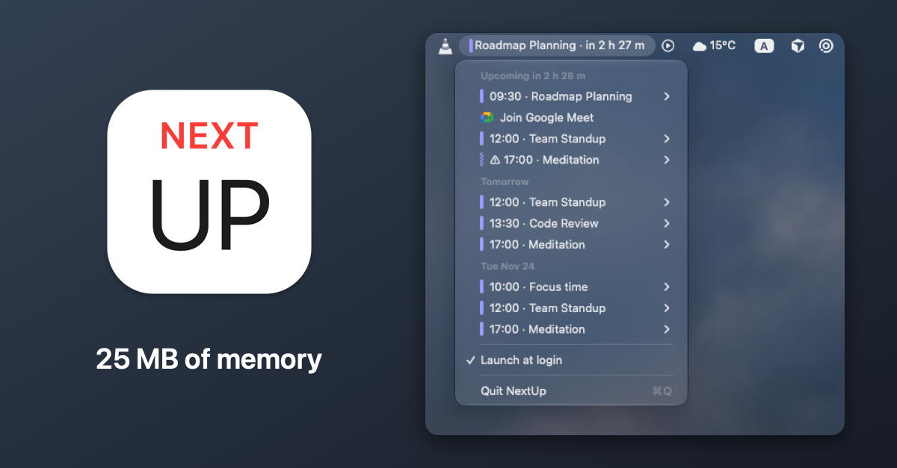

# NextUp

<p align="center"></p>

A small macOS menu bar app: your next calendar event with a countdown, today and the next 2 days, and a Google Meet link one click away, with a Join panel one minute before each meeting. It replaces a much heavier calendar app's menu bar item, in a few tens of megabytes.

Needs macOS 14 or later (Apple silicon or Intel). It reads the calendars on your Mac, stores nothing and has no network code.

## Install

1. Quit NextUp if it's running: Finder can't replace a running copy.
2. Download `NextUp-<version>.dmg` from [Releases](https://github.com/Kaaveh/NextUp/releases/latest), open it and drag **NextUp** onto **Applications**.
3. Eject the DMG and open NextUp from Applications, never from the DMG window.

<!-- Screenshot: the DMG window, NextUp beside the Applications link. -->

**First launch.** NextUp isn't notarized, so macOS blocks it once. Click **Done**, then **System Settings → Privacy & Security → Open Anyway**, and confirm. Or in Terminal:

```
xattr -dr com.apple.quarantine /Applications/NextUp.app
```

<!-- Screenshot: Privacy & Security with the Open Anyway button for NextUp. -->

Then allow calendar access. Without it, the menu offers `Open Privacy Settings…`.

**Updating.** Install the new DMG the same way and choose **Replace**. Each release is a new ad-hoc build, so macOS may ask for calendar access and Open Anyway again.

### Build from source

Needs Xcode with Swift 6.2 or later.

```
scripts/install.sh    # builds, signs with your Apple Development identity (or ad-hoc), installs to /Applications
```

## Develop

```
swift build
swift test
scripts/check.sh      # tests, bundle and a 5-second self-check with sample events; needs a desktop session
```

## How to cut a release

1. In `Support/Info.plist`, set `CFBundleShortVersionString` and raise `CFBundleVersion`; commit on `main`.
2. `git tag v1.2.0 && git push origin v1.2.0`. The Release workflow tests, builds the DMG and publishes it. A tag like `v1.2.0-rc1` becomes a pre-release.
